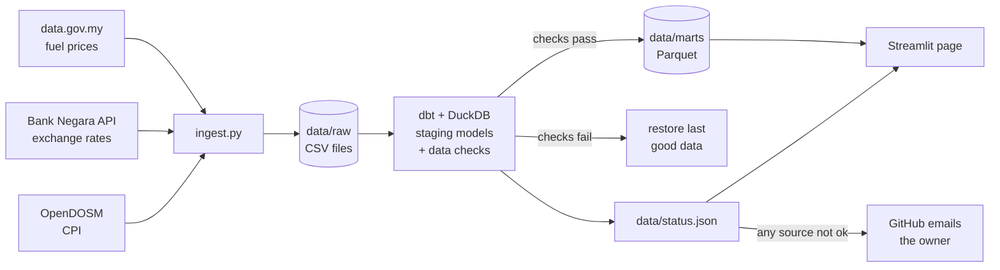

# Malaysia Cost of Living Data Pipeline

A data pipeline that runs itself. Every day it collects Malaysia's **fuel prices**, the **ringgit's exchange
rates** and **inflation by state**, checks the data, models it in SQL with dbt, and publishes it to a web page.
Nobody touches it: the dates on the page move forward on their own.

**Live page:** https://malaysia-cost-of-living-data-pipeline.streamlit.app/  
**Run history:** [GitHub Actions](https://github.com/szal31/Malaysia-Cost-of-Living-Data-Pipeline/actions)

## What it shows

- **This week's fuel prices.** RON95 has a market price (RM4.42 a litre on 29 Oct 2026), while eligible
  Malaysians pay RM1.99 under the BUDI95 targeted subsidy. Prices go back to 2017.
- **Today's ringgit** against 26 currencies from Bank Negara's 5pm closing rates, back to November 2020.
- **The latest inflation** nationally and for each state, back to 2010 (same data as my
  [Power BI dashboard](https://github.com/szal31/Malaysia-Inflation-Dashboard-Using-PowerBI)).
- **Pipeline health:** when the last run happened, whether each source passed its checks, and how fresh it is.

## How it works



A GitHub Actions job (`.github/workflows/daily.yml`) runs `run.py` at 6pm Malaysia time every day, after
Bank Negara publishes its closing rates.

| Step | File | What it does |
|---|---|---|
| 1 | `ingest.py` | Downloads each source. Exchange rates are stored one CSV per month, so a daily update rewrites one small file instead of a growing one. |
| 2 | `dbt/` | Staging models clean and type the raw files; data checks run on them; marts are written as Parquet for the page. Exchange rates are written one file per month, so the repo doesn't grow by a whole file every day. |
| 3 | `run.py` | Handles each source on its own: backs up its files, downloads, runs its dbt models and checks, and puts the backup back if anything fails. Writes `data/status.json` every run. |
| 4 | `.github/workflows/daily.yml` | Runs the pipeline, commits the data if it changed, and fails the job if any source didn't update, so GitHub emails me. |
| 5 | `app.py` | The Streamlit page. It only reads the published files, so it is fast and can't show half-processed data. |
| 6 | `keepalive.py` | Opens my other Streamlit apps in a headless browser every day, and wakes any that have gone to sleep. A plain web request doesn't count as a visit to Streamlit. |

## Data checks

The checks are dbt tests (`dbt/models/schema.yml`). A source is only published if all its checks pass.

| Source | Checks |
|---|---|
| Fuel | At least 400 weeks; dates unique; no gap over 14 days since 2019; RON95 between RM1 and RM6 and diesel between RM1 and RM8 a litre; no week-on-week jump over 75% |
| Exchange rates | At least 20,000 rows; one rate per currency per day; no gap over 10 days; buying above zero and below selling; USD between RM3 and RM6; no daily move over 5% for major currencies |
| Inflation | At least 40,000 rows; one value per state, month and category; index between 50 and 300; all 17 regions (16 states plus Malaysia) reach the same latest month |
| All | Freshness: fuel no older than 10 days, exchange rates 7 days, inflation 100 days (DOSM publishes each month about 50 days after it starts) |

Some limits come from real events found in the data, not guesses:
- **The gap check starts in 2019,** because fuel prices were frozen in 2018 and set monthly.
- **The jump limit allows 75%,** because diesel really rose 56% in one week in June 2024 when its subsidy was
  targeted.
- **The 5% daily limit covers only major currencies,** because the Egyptian pound really fell about 40% in a
  day in March 2024.

To prove the checks work, I planted a RON95 price of RM9.99. Two checks failed (price range, and sudden
jump), and the previous fuel data was put back.

## What happens when something breaks

- **A source is down, empty or changes its format.** That source is marked failed and keeps its last good
  data. The other two still update.
- **A source stops publishing.** For example, if DOSM publishes the CPI late, the source turns "late" once it
  passes its freshness limit.
- **The whole job stops running.** The page works out each source's age when it opens, and warns if the
  pipeline hasn't run for two days, so it can't keep showing "ok" forever.
- **In every case** the page shows a warning and the health section turns red or orange, and the GitHub job
  fails, so I get an email.

## Run it

Uses Python 3.14.

```bash
py -3.14 -m venv .venv
.venv\Scripts\activate
pip install -r requirements-pipeline.txt -r requirements-dev.txt
python run.py           # collect, check and publish (the first run downloads all history, about 15 minutes)
streamlit run app.py
pytest                  # 25 tests; no network needed
```

To run only the models and checks: `dbt build --project-dir dbt --profiles-dir dbt`.

## Data and credits

- **Fuel prices:** [data.gov.my](https://data.gov.my/data-catalogue/fuelprice) (CC BY 4.0).
- **Consumer price index:** [OpenDOSM](https://open.dosm.gov.my), Department of Statistics Malaysia
  (CC BY 4.0).
- **Exchange rates:** Source: Bank Negara Malaysia, from its public
  [Open API](https://www.bnm.gov.my/-/bnm-openapi). This project is not affiliated with or endorsed by Bank
  Negara Malaysia.
